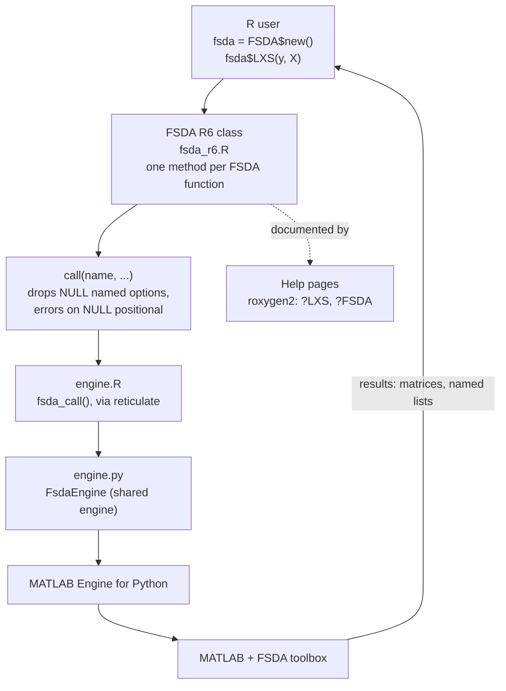

# Architecture

The R side of FSDA Bridge is one **R6 class**, `FSDA`, on top of the shared engine.
One `FSDA` object holds one MATLAB session.

## Layers

| Layer | File | Role |
|---|---|---|
| R6 class | `fsdabridge/R/fsda_r6.R` | One method per FSDA function; `$` gives tab completion |
| Docs | `fsdabridge/R/fsda-methods-doc.R` | One help page for the class, one per method (`@name <fn>`, `@usage NULL`) |
| R engine | `fsdabridge/R/engine.R` | Starts the engine and calls it through reticulate |
| Shared engine | `fsdabridge/inst/python/engine.py` | The same engine used by the Python and Julia sides |
| MATLAB | FSDA toolbox | Does the computation and draws the plots |

## Adding a function

Each new FSDA function follows the same four steps:

1. Add the method to `fsda_r6.R` (forward to `self$call()`; plots use `nargout = 0` and `render_figures()`).
2. Document it in `fsda-methods-doc.R`, then run `roxygen2::roxygenise()`.
3. Check it live against MATLAB.
4. Add a line to the demo.
